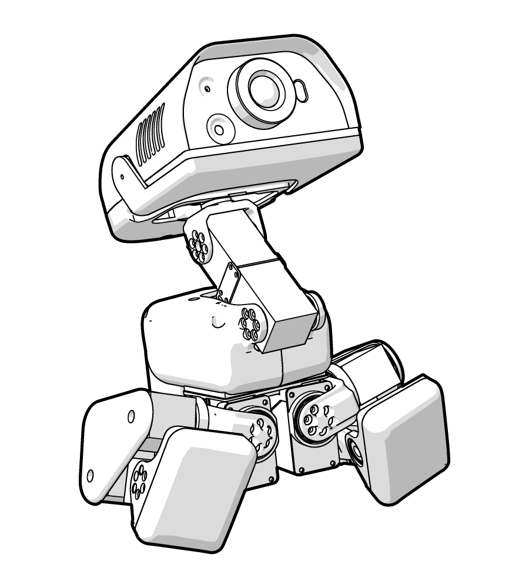
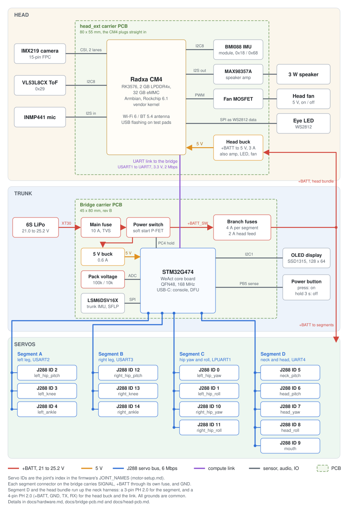

# Dukki

A rework of the Pollen Robotics [Microduck](https://github.com/pollen-robotics/microduck) with a few hardware changes:

- Radxa CM4 brain (instead of the Radxa Zero 3W)
  - RK3576 vs RK3566: roughly twice the CPU and a 6 TOPS NPU vs 0.8 TOPS
- Unitree J288 servos (instead of the Dynamixel XL330-M288-T)
  - About three times faster: 35 rad/s (25 V), vs about 11 rad/s for the XL330
  - Twice the weight: 39 g vs 18 g
  - Somewhat more peak torque: about 0.55 to 0.6 N·m measured at the output, against 0.43 N·m for the XL330 as the RL project trains with it

 

> [!IMPORTANT]
> Everything in here is very much a work in progress!

## Hardware block diagram

## What's in this repository

This repository holds the Dukki documentation, the hardware design files (KiCad), and the code that doesn't fit neatly into one of the forked repos, such as the STM32 servo bridge firmware, compute module setup scripts and J288 bench test tools. Changes elsewhere live on branches of forked repos: the robot firmware in [microduck](https://github.com/lachlanhurst/microduck/tree/dukki) (`dukki`), RL training in [microduck_rl](https://github.com/lachlanhurst/microduck_rl/tree/dukki-j288) (`dukki-j288`), the J288 actuator model in [bam](https://github.com/lachlanhurst/bam/tree/unitree-j288) (`unitree-j288`) and the head IMU driver in [bmi088-rs](https://github.com/lachlanhurst/bmi088-rs/tree/configurable-addresses) (`configurable-addresses`).

## Docs

[Hardware](docs/hardware.md) is the main design document. It covers each subsystem (servos, compute, the STM32 servo bridge, IMUs, power, audio, camera, ToF) and compares it with the OG robot.

[Compute setup](docs/compute-setup.md) takes a Radxa CM4 from the box to a board on WiFi at `microduck.local`. That includes flashing Armbian to the eMMC.

[Servo setup](docs/motor-setup.md) is the bench procedure for each J288 before assembly. You set the bus ID with Unitree's Windows tool, record the firmware version, run a motion check and label the servo for its joint.

[J288 bench testing](docs/j288-testing.md) has the results from characterising one servo: bus timing, friction, armature, torque limits and heating. The main finding is that peak driving torque at the output is about 0.55 to 0.6 N·m, not the 1.5 N·m on Unitree's page, and somewhat above the XL330 as trained (0.43 N·m).

[Policy testing](docs/policy-testing.md) records the first runs of a trained walk policy on the robot: matching robotd to training, choosing the policy, the loop's timing, the IMU median and kd, and why the robot stays more restless than the simulation.

[Camera setup](docs/camera-setup.md) and [audio setup](docs/audio-setup.md) bring up the IMX219 camera and the MAX98357A speaker and INMP441 microphone on the CM4.

[Expression outputs](docs/express-setup.md) brings up the eye LED and the head fan, and the `expressd` daemon that drives them.

[Head carrier PCB](docs/head-pcb.md) is the design note for the CM4 carrier in the head (head_ext as built), which replaces the Waveshare CM4-NANO-A and the loose head breakouts.

[Bridge carrier PCB](docs/bridge-pcb.md) is the design note for the trunk board that carries the STM32 bridge and the trunk IMU, with the soft power switch, the 5 V buck and the fused servo segments.

## Licence

MIT, see [LICENSE](LICENSE), except for the 3D model files below.

The 3D model files in [hardware/cad/stl/](hardware/cad/stl/) are adapted from Pollen Robotics' Microduck models ([microduck_rl](https://github.com/pollen-robotics/microduck_rl)) and modified for Dukki. Like the originals, they are licensed under the [Creative Commons Attribution-NonCommercial-ShareAlike 4.0 International licence (CC BY-NC-SA 4.0)](https://creativecommons.org/licenses/by-nc-sa/4.0/), not MIT. If you share them or anything made from them, credit Pollen Robotics and license your version under CC BY-NC-SA 4.0 too. That is a summary only; the [legal code](https://creativecommons.org/licenses/by-nc-sa/4.0/legalcode) is what applies.

The third-party datasheets and schematics in [docs/datasheets/](docs/datasheets/) belong to their publishers and are not covered by it.
